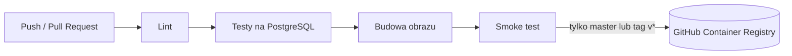
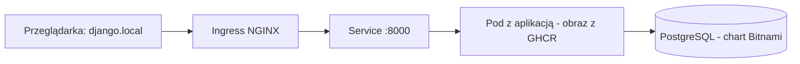

# WUDA – wdrożenie aplikacji Django „Polls”

Projekt z przedmiotu _Wdrażanie i utrzymywanie dostępnych aplikacji_. Bierzemy gotową aplikację internetową do ankiet (tutorial Django „Polls”) i przygotowujemy ją do pracy w warunkach produkcyjnych: automatyczne sprawdzanie kodu, budowa obrazów Docker, wdrożenie na klastrze Kubernetes, a na końcu monitoring.

Zespół: [crypaipal](https://github.com/crypaipal), [krzyfok](https://github.com/krzyfok)

| Etap | Zakres                                                             | Status     |
| ---- | ------------------------------------------------------------------ | ---------- |
| 1    | Docker, potok CI/CD, publikacja obrazu w GitHub Container Registry | zrobione   |
| 2    | Helm chart i wdrożenie na klastrze Kubernetes                      | zrobione   |
| 3    | Monitoring, alerty, logi i metryki (OpenTelemetry)                 | w procesie |

---

## Etap 1 – Docker i potok CI/CD

### Co zmieniliśmy w aplikacji

Wzięliśmy aplikację Django z tutoriala, która działała tylko w trybie deweloperskim (SQLite, runserver, sekrety w kodzie, Django 2.0). Zmieniliśmy ją tak, żeby ten sam kod działał lokalnie, w testach i na serwerze – różnią się tylko ustawienia podawane z zewnątrz.

- **Ustawienia ze zmiennych środowiskowych** – hasła, tajny klucz i tryb debugowania nie są już zapisane w kodzie, tylko podawane przy uruchomieniu.
- **PostgreSQL zamiast SQLite** – SQLite to pojedynczy plik, dobry do nauki. PostgreSQL to osobny serwer bazy danych, z którego może naraz korzystać wiele kopii aplikacji. SQLite zostaje tylko do szybkiej pracy lokalnej.
- **Gunicorn zamiast serwera deweloperskiego** – wbudowany serwer Django nie jest przeznaczony do produkcji. Gunicorn obsługuje wiele zapytań równolegle.
- **WhiteNoise** – serwuje pliki CSS i obrazki, gdy aplikacja działa w trybie produkcyjnym.
- **Django 5.2 LTS** – aktualna wersja ze wsparciem bezpieczeństwa (wcześniej 2.0). Dostosowaliśmy do niej testy.

### Obraz Docker

`Dockerfile` opisuje, jak zbudować „paczkę” z aplikacją i wszystkim, czego potrzebuje do działania. Obraz jest mały, działa na zwykłym użytkowniku (nie administratorze) i od razu zawiera pliki statyczne.

### Potok CI/CD

Przy każdej zmianie w kodzie GitHub Actions automatycznie sprawdza i buduje aplikację:



1. **Lint** – sprawdza styl i typowe błędy w kodzie (narzędzie `ruff`).
2. **Testy** – uruchamia testy aplikacji na prawdziwej bazie PostgreSQL.
3. **Budowa i smoke test** – buduje obraz, uruchamia go razem z bazą i sprawdza, czy strona odpowiada.
4. **Publikacja** – działający obraz trafia do rejestru `ghcr.io/crypaipal/wuda-django-tutorial`. Na Pull Requestach potok tylko sprawdza kod, niczego nie publikuje.

Każdy obraz dostaje tag z identyfikatorem commita (`sha-xxxxxxx`), więc zawsze wiadomo, z której wersji kodu pochodzi. Wersja z gałęzi `master` dostaje dodatkowo tag `latest`.

### Uruchomienie

Wymagany Docker z Docker Compose:

```bash
cp .env-example .env
docker compose up -d
docker compose exec web python manage.py migrate
docker compose exec web python manage.py createsuperuser
```

Aplikacja: http://localhost:8000/polls/, panel administracyjny: http://localhost:8000/admin/.

Bez Dockera (tryb deweloperski z SQLite): plik `.env.local` z `DJANGO_SECRET_KEY` i `DJANGO_DEBUG=true`, następnie `pip install -r requirements.txt` i `python manage.py runserver`.

### Zmienne środowiskowe

| Zmienna                                                                               | Opis                                                              |
| ------------------------------------------------------------------------------------- | ----------------------------------------------------------------- |
| `DJANGO_SECRET_KEY`                                                                   | tajny klucz Django                                                |
| `DJANGO_DEBUG`                                                                        | `true` tylko w developmencie, domyślnie `false`                   |
| `DJANGO_ALLOWED_HOSTS`                                                                | adresy, pod którymi działa aplikacja, oddzielone przecinkami      |
| `DJANGO_CSRF_TRUSTED_ORIGINS`                                                         | zaufane adresy HTTPS dla formularzy (gdy aplikacja stoi za proxy) |
| `POSTGRES_DB`, `POSTGRES_USER`, `POSTGRES_PASSWORD`, `POSTGRES_HOST`, `POSTGRES_PORT` | połączenie z PostgreSQL; bez `POSTGRES_DB` aplikacja używa SQLite |
| `DJANGO_LOG_LEVEL`                                                                    | poziom logów, domyślnie `INFO`                                    |

---

## Etap 2 – Kubernetes i Helm

Kubernetes uruchamia kontenery na klastrze maszyn, pilnuje, żeby działały, i kieruje do nich ruch. Helm to „instalator” dla Kubernetesa: chart w katalogu `django-app/` to szablon, który jednym poleceniem tworzy wszystkie potrzebne elementy.



- **Deployment** – uruchamia aplikację z obrazu z GHCR, w zadanej liczbie kopii.
- **Service** – stały adres aplikacji wewnątrz klastra.
- **Ingress** – wpuszcza ruch z zewnątrz pod adresem `django.local`.
- **PostgreSQL** – baza danych uruchamiana na klastrze jako zależność charta (Bitnami), z trwałym dyskiem na dane.

### Konfiguracja (`django-app/values.yaml`)

| Klucz                           | Co ustawia                          |
| ------------------------------- | ----------------------------------- |
| `image.repository`, `image.tag` | który obraz aplikacji wdrożyć       |
| `replicaCount`                  | liczba kopii aplikacji              |
| `django.secretKey`              | tajny klucz Django                  |
| `django.allowedHosts` | autoryzowane domeny (np. `django.local`)      | 
| `postgresql.auth.*`             | nazwa bazy, użytkownik i hasło      |
| `ingress.*`                     | adres aplikacji i kontroler Ingress |

### Wdrożenie

**Wymagania:** Klaster Kubernetes (np. Minikube) oraz zainstalowane `kubectl` i `helm`. Jeśli używasz systemu Windows, dodaj wpis `127.0.0.1 django.local` w pliku `C:\Windows\System32\drivers\etc\hosts`.
1. **Przygotowanie klastra (włączenie routera):**

   ```
   minikube addons enable ingress
   
   ```

2. **Pobranie zależności i instalacja aplikacji:**

   ```
   helm repo add bitnami https://charts.bitnami.com/bitnami
   helm dependency build ./django-app
   helm install polls ./django-app
   
   ```

3. **Oczekiwanie na gotowość kontenerów:**
   Poczekaj, aż wszystkie pody osiągną status `Running` 1/1 (wyjdź skrótem `Ctrl+C`):

   ```
   kubectl get pods -w
   
   ```

4. **Wykonanie migracji i utworzenie admina (gdy pody już działają):**

   ```
   kubectl exec deploy/polls-django-app -- python manage.py migrate
   kubectl exec -it deploy/polls-django-app -- python manage.py createsuperuser
   
   ```

5. **Dostęp do aplikacji:**
   Otwórz **nowe okno terminala** i uruchom tunel sieciowy (zostaw go działającego w tle):

   ```
   minikube tunnel
   
   ```

   Aplikacja jest teraz dostępna w przeglądarce pod adresem: <http://django.local>
   
Wdrożenie nowej wersji: `helm upgrade polls ./django-app --set image.tag=sha-xxxxxxx`, powrót do poprzedniej: `helm rollback polls`.
